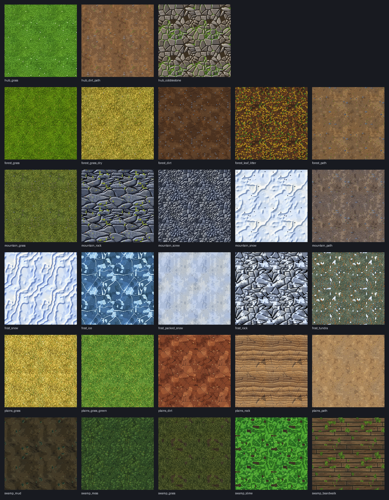

# Terrain Textures

> Status: draft v1 · Owner: J00BA · Last updated: 2026-10-30
>
> The tiling ground textures for the hub world and the resource world: which textures exist, what each one looks like, how they are made and how Godot blends them into the terrain. This doc must agree with `game_worlds.md` (sections 2, 4.8 and 4.9) and `blockbench_detailed_prompts.md` (sections 1.5, 3.12 and 5). Where they differ, those docs win.
>
> **In scope:** hub, forest, mountain, frost, plains and swamp. **Not yet:** void and stellar (they float, use separate island meshes, and come later).

---

## 1. Rules

These come from `blockbench_detailed_prompts.md` section 3.12 and section 1.5.

| Rule | Value |
| --- | --- |
| Size | **128 × 128** pixels for every terrain texture |
| Texel density | **32 px per metre**, so one tile covers **4 × 4 metres** of ground (same pixel size as the models) |
| Tiling | Seamless in both directions. Checked with a 3 × 3 preview |
| Format | RGB PNG, no alpha |
| Colour | Hue shifted ramps of 5 to 8 shades (shadows cooler, highlights warmer). No pure black or white. 40 to 120 colours per texture where possible |
| Detail | 3 layers: base ramp noise in 2 to 4 px clusters, mid size shapes (grass blades, stones, cracks, ripples, planks), small accents (pebbles, flowers, sparkles) |
| Light | Baked from the top left, like the models: top-left edges lighter, bottom-right edges and contact points darker |
| Name | `<biome>_<surface>.png`, lowercase with `_` |
| Folder | `godot-game/assets/textures/terrain/` |

Godot import for every terrain texture: **filter Nearest with mipmaps**, repeat on, no compression loss that blurs pixels (Lossless or VRAM compressed with the "pixel art" look checked in the web build).

---

## 2. Texture list

The **layer index** is the slot the texture takes in the terrain `Texture2DArray` (section 4). Keep the order fixed: the terrain shader refers to layers by index. New textures go on the end.

The full colour ramps are in `tools/generate_terrain_textures.py` (dictionary `R`). The table shows each texture's main ramp from dark to light.

### 2.1 Hub

The hub isn't in `game_worlds.md` section 4.8, so its set is new. It is a tidy village: clean lawn, trodden paths and a cobbled square.

| Layer | Id | Role | Main ramp | Mid layer | Accents |
| --- | --- | --- | --- | --- | --- |
| 0 | `hub_grass` | Base ground, the "grass floor" | `#284a14` → `#86c444` | Dense short blades (2 to 4 px), clumps | White daisies with yellow centres |
| 1 | `hub_dirt_path` | Paths between landmarks | `#3a2a1e` → `#b89066` | Packed earth with lighter worn streaks | Gravel, flat warm stones, stray grass blades |
| 2 | `hub_cobblestone` | Village square, castle approach, crafting area | `#2a2828` → `#c0b8ac` | Rounded cobbles with a bevelled edge, dark mortar | Moss and grass in the gaps |

### 2.2 Forest (depth 1)

From `game_worlds.md` section 4.8.1. The grass uses the same colours as the forest grass tufts (`#4d6f0d` to `#7aad1d`, section 4.10) so the foliage blends into the ground.

| Layer | Id | Role | Main ramp | Mid layer | Accents |
| --- | --- | --- | --- | --- | --- |
| 3 | `forest_grass` | Base ground | `#283f10` → `#7aad1d` | Dense lime green blades (2 to 5 px), clumps | A few golden blades, white and yellow specks |
| 4 | `forest_grass_dry` | Golden dry patches (river reference) | `#463c14` → `#e4d26e` | Longer leaning olive gold blades | Green blades mixed in, blue flowers |
| 5 | `forest_dirt` | Bare earth, riverbanks, under rock outcrops | `#2a1a14` → `#9a7249` | Clumpy soil, wandering roots | Grey pebbles, light grit, a few dead leaves |
| 6 | `forest_leaf_litter` | Ground under trees | `#2a1a14` → `#9a7249` (soil) | Hundreds of fallen leaves in green, birch yellow and brown, each with a midrib | Twigs |
| 7 | `forest_path` | Dirt paths | `#3a2a20` → `#ba9a6e` | Packed earth with lighter worn streaks | Grey gravel, flat stones, stray grass blades |

### 2.3 Mountain (depth 2)

From `game_worlds.md` section 4.8.2.

| Layer | Id | Role | Main ramp | Mid layer | Accents |
| --- | --- | --- | --- | --- | --- |
| 8 | `mountain_grass` | Base ground on slopes and valleys | `#262e14` → `#9aa44c` | Olive blades, wind leaning | Purple heather clusters, dry blades, small stones |
| 9 | `mountain_rock` | Cliffs and steep slopes | `#1c2030` → `#b0b6c2` | Wide, layered, jagged slabs with strata bands and cracks | Lichen (olive and orange) |
| 10 | `mountain_scree` | Loose stone slopes below cliffs | `#1c2030` → `#b0b6c2` | Hundreds of small shaded stones, dark gaps | A few big stones, lichen specks |
| 11 | `mountain_snow` | Peaks only | `#8296b6` → `#f6f8fb` | Soft wind ripples, blue shadows | Sparkles, small rocks poking through |
| 12 | `mountain_path` | Rocky paths and switchbacks | `#2a2220` → `#c0ae9c` | Packed warm stone earth with worn streaks | Lots of blue grey gravel, flat stones |

### 2.4 Frost (depth 3)

From `game_worlds.md` section 4.8.3.

| Layer | Id | Role | Main ramp | Mid layer | Accents |
| --- | --- | --- | --- | --- | --- |
| 13 | `frost_snow` | Base ground | `#7088be` → `#f4f7fc` | Strong wind ripples (sharp crests, blue troughs) | Sparkles, orange grass tips |
| 14 | `frost_ice` | Frozen lakes, ice cliffs | `#1a3048` → `#d0ecf8` | Deep and light patches, big white cracks, fine cracks | Frost patches, bubbles, glints |
| 15 | `frost_packed_snow` | Paths | `#66748e` → `#e8eef4` | Trodden streaks, pressed dents | Grit, ice glints |
| 16 | `frost_rock` | Outcrops and steep slopes | `#343c4c` → `#c8d0da` | Pale stone slabs with cracks | Snow caps on top |
| 17 | `frost_tundra` | Edges of the biome, borders with mountain and plains | `#28342e` → `#9ca890` | Green grey blades | Orange tundra grass, small snow patches, stones |

### 2.5 Plains (depth 4)

From `game_worlds.md` section 4.8.4.

| Layer | Id | Role | Main ramp | Mid layer | Accents |
| --- | --- | --- | --- | --- | --- |
| 18 | `plains_grass` | Base ground, the golden steppe | `#54441a` → `#f0e08a` | Long (4 to 7 px) leaning gold and straw blades | Green blades, white and purple flowers |
| 19 | `plains_grass_green` | Patches near water | `#264214` → `#9cc658` | Fresh green blades | Straw blades, yellow flowers |
| 20 | `plains_dirt` | Dry riverbeds, bare ground | `#381a14` → `#c4804e` | Red brown dry earth with crack network, dust patches | Sandy grit, pebbles, stray blades |
| 21 | `plains_rock` | Mesas, arches and pillars | `#46302a` → `#e4c492` | Horizontal sandstone layers with ledges | Fine cracks, light grit |
| 22 | `plains_path` | Paths | `#584230` → `#dcc092` | Dusty packed earth with worn streaks | Sandy gravel, gold blades |

### 2.6 Swamp (depth 5)

From `game_worlds.md` section 4.8.5.

| Layer | Id | Role | Main ramp | Mid layer | Accents |
| --- | --- | --- | --- | --- | --- |
| 23 | `swamp_mud` | Base ground, mud flats | `#1a1814` → `#6c6644` | Dark mud, shallow murky puddles with a light rim, cracks on drier parts | Wet glints, bubbles in puddles, twigs |
| 24 | `swamp_moss` | Raised islands, around tree roots | `#18261a` → `#6c9046` | Spongy cushions of moss | Light tips, yellow spore stalks |
| 25 | `swamp_grass` | Islands | `#1a2012` → `#70783c` | Long dark olive blades | Damp mud patches, moss specks |
| 26 | `swamp_slime` | Near dreadstone only | `#163416` → `#c8ee84` | Swirling toxic green slime | Bubbles with highlights, dark mud blobs |
| 27 | `swamp_boardwalk` | Boardwalk paths (also usable on plank meshes) | `#22191a` → `#9c8262` | Rows of planks (0.5 m wide) with grain, staggered ends and dark gaps | Nails, knots, moss |

### 2.7 Preview

All 28 textures, each tiled 2 × 2 (regenerate with `--preview`, section 3):



---

## 3. How they are made

The textures are generated by **`tools/generate_terrain_textures.py`** (Python 3 with `numpy` and `pillow`), so the whole set stays consistent and can be tuned quickly.

- Everything that makes a texture (noise, Voronoi stones, blades, cracks, ripples) wraps around the edges, so every texture tiles.
- Each texture has its own fixed seed, so running the script again gives the same images.
- To tune a texture, change its ramp in `R` or its function, then run the script again.

```
python3 tools/generate_terrain_textures.py              # writes the 28 PNGs
python3 tools/generate_terrain_textures.py --preview    # also writes 3 x 3 previews and a contact sheet
```

The generated set is the **starting point**. Any texture can be replaced by a hand painted one (Aseprite) with the same name and size. If you do, stop regenerating that texture (remove it from `TEXTURES` in the script) so it isn't overwritten.

---

## 4. Using them in Godot

How the terrain uses the textures. This follows `game_worlds.md` section 4.9: one heightmap terrain, about 4 to 5 textures per biome, blended at the borders.

### 4.1 Loading

- Load all layers into one **`Texture2DArray`** in the layer order from section 2 (for example with `Texture2DArray.create_from_images()` after generating mipmaps on each image).
- Sample them with `filter_nearest_mipmap` and repeat on, so pixels stay crisp up close.
- **UVs come from world position:** `uv = world_position.xz / 4.0` (one tile per 4 metres). Never stretch them with the terrain.
- On steep slopes, sample the rock layers **triplanar** so cliffs don't smear.

### 4.2 Which texture goes where

Each biome uses its own set. Inside a biome, the shader picks layers by these rules (thresholds are starting points; tune them in Godot):

| Biome | Base | Patches (noise) | Steep slopes | High ground | Low and wet | Paths |
| --- | --- | --- | --- | --- | --- | --- |
| Hub | `hub_grass` | none | `forest_dirt` (borrowed) | none | `forest_dirt` by water | `hub_dirt_path`, `hub_cobblestone` (square, castle, crafting area) |
| Forest | `forest_grass` | `forest_grass_dry`, `forest_leaf_litter` under tree clusters | `forest_dirt` | none | `forest_dirt` on riverbanks | `forest_path` |
| Mountain | `mountain_grass` | `mountain_scree` below cliffs | `mountain_rock` | `mountain_snow` on the peaks | `mountain_scree` by streams | `mountain_path` |
| Frost | `frost_snow` | `frost_tundra` near the borders | `frost_rock` | `frost_snow` | `frost_ice` on frozen lakes | `frost_packed_snow` |
| Plains | `plains_grass` | `plains_grass_green` near water | `plains_rock` | `plains_rock` on mesa tops | `plains_dirt` in dry riverbeds | `plains_path` |
| Swamp | `swamp_mud` | `swamp_grass` and `swamp_moss` on raised islands, `swamp_slime` around dreadstone | `swamp_mud` | `swamp_grass` | `swamp_mud` | `swamp_boardwalk` |

- **Biome borders** blend over 30 to 60 metres (`game_worlds.md` section 4.7). Inside the border, the two biomes' layers mix.
- **Blend in pixel steps**, not smooth fades: use a dithered or height based blend snapped to the 32 px per metre grid, so transitions keep the pixel look (grass blades poke over the dirt instead of a soft gradient).
- **Paths** come from a path mask (1 pixel per metre) painted along the path lines.
- **Ground cover matches the ground:** grass tufts in each biome use that biome's grass ramp (`game_worlds.md` section 4.10).
