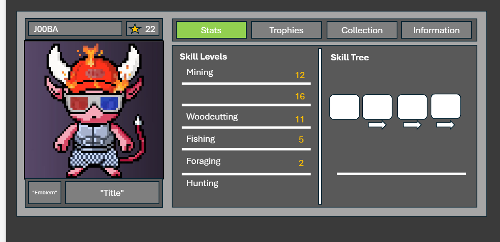

# Build the player profile menu (P)

Repo: `joobajooba/club-impz`. Follow the GitHub workflow in the root `CLAUDE.md`: work on a `staging/player-profile-menu` branch, open a **draft** PR, never push to the default branch. The code stack is open as stacked staging PRs, so branch from the **top of the stack** (today `staging/world-chat`, PR #56; check with `git fetch` and the open PRs first) and set the PR base to that branch.

Read these before writing any code, in this order:

1. `docs/game_menus.md` (on `staging/game_menus`, PR #33 until it merges). **This is the menu design doc. Follow it exactly.** Sections 1, 3 (the Profile row), 3.5, 4 and 5 all apply to this menu.
2. `docs/game_direction.md` sections 6 (level, prestige, skills, skill trees), 7 (challenges, trophies, titles, emblems) and 9 (player profile). Where it and `game_menus.md` differ, `game_direction.md` wins.
3. `docs/CLAUDE.md`: do not deviate, label every rule **Decided**, **Proposed** or **Open question**, never invent a design that isn't written down.
4. The code you will reuse: `godot-game/ui/ui_kit.gd`, `godot-game/ui/customizer_menu.gd` (the turning 3D Imp preview), `godot-game/autoload/look.gd`, `godot-game/ui/profile/profile_ui.gd` and `account_panel.gd`, `godot-game/ui/hud.gd` (the player card), `godot-game/autoload/game_data.gd` (`SKILLS`, `MAX_LEVEL`).

Build the **player profile menu**: one window where the player sees their whole Imp, their skill levels and skill trees, their trophies, their collection (Impz first) and their account info, and picks which **title** and **emblem** they show. It must look and behave like every other menu in the game.

## Reference

J00BA's mockup: `docs/images/player_profile_menu/mockup.png`.



Take the **layout** from the mockup. Take the **look** (colours, frame, font, pixel scale) from `game_menus.md` section 5, not from the mockup's flat greys. The mockup is a layout sketch.

## What the mockup shows, and what to build from it

```
┌ Profile ─────────────────────────────────────────────────────────── [P] [Close] ┐
│ ┌ J00BA ──────────────┐ ┌ ★ 22 ┐   [Stats] [Trophies] [Collection] [Information] │
│ ┌─────────────────────────────┐   ┌──────────────────────────────────────────────┐│
│ │                             │   │ Skill Levels           │ Skill Tree: Mining   ││
│ │   (the player's Imp, 3D,    │   │ Mining            12   │                      ││
│ │    full body, turning)      │   │ ▓▓▓▓▓▓░░░░░░░░░░░░░░   │ [■]→[■]→[■]→[ ]      ││
│ │                             │   │ Lumbering         11   │                      ││
│ │                             │   │ ▓▓▓▓▓░░░░░░░░░░░░░░░   │                      ││
│ │                             │   │ Fishing            5   │ ──────────────────── ││
│ │                             │   │ Foraging           2   │ (selected node info) ││
│ └─────────────────────────────┘   │ Hunting            1   │                      ││
│ [Emblem] [        Title        ]  └──────────────────────────────────────────────┘│
└────────────────────────────────────────────────────────────────────────────────────┘
```

### Window (Proposed in `game_menus.md` section 3, rules in sections 4 and 5)

- **P** opens and closes it (the Profile row of section 3; P is not bound today). Esc closes it (section 4.1, including the browser rule: Esc closes the top menu first). Add a `profile` input action in `project.godot` like `customize`.
- **Clicking the HUD player card** opens this menu. Today it opens `ProfileUI.open_menu()` (the wallet and account menu). Change the card to open the new menu; the Profile icon button top right keeps opening the account menu.
- One modal window in the shared frame: `UIKit.panel` (dark blue-black fill, gold bevelled frame, corner studs), Pixelify Sans, everything at `UIKit.PX` (3 screen pixels per art pixel), whole-number scale only. Title "Profile" in gold with the 2-pixel drop shadow. Show the **[P]** key cap in the title bar (section 4.1, "show the key on every button").
- The world keeps running behind it and is not blacked out (section 4.1). The player can't move while it is open, like the customizer (section 3.5).
- Opens with the 95% → 100% scale and fade in about 0.1 s (section 5.2, Motion). Button clicks use the UI click sound if the build has one.
- Every button and slot is at least **44 screen pixels** (section 4.5). Nothing works only on hover: every hover detail also shows on click.
- Opening a menu over another replaces it (section 4.1): opening the profile closes the inventory, customizer or a station window, and the other way round.

### Left panel (Decided, `game_direction.md` section 9)

Top to bottom, as in the mockup:

1. **Name bar**: the impz.club **username** (`AccountPanel.saved_name()`). With no username, show "No username yet" in muted text. Beside it a small box with the **prestige icon** and the **player level** (the mockup's "★ 22"). The icon is `prestige_<n>.png` from `godot-game/assets/sprites/source/items/` (`game_direction.md` section 6.1), shown at 1× or 2×, nearest filter (section 5.2, Icons).
2. **The Imp, full body**: the player's Imp as it is worn now (`Look.shown()`), in a turning 3D view built the same way as the customizer preview (`customizer_menu.gd`: `SubViewportContainer`, `SubViewport`, `Camera3D`, the same `TARGET`). Drag turns it, the wheel zooms, like the customizer. Frame it so the whole Imp shows, head to feet, as in the mockup. The background is a recessed `UIKit.slot` box in a flat colour, not a gradient (section 5.3). It updates when `Look.changed` fires. Add a small **Customize [C]** button under the view that opens the customizer.
3. **Emblem box** (square) and **Title box** (wide), side by side under the Imp. Clicking either opens its picker (below). With nothing equipped they read "No emblem" and "No title" in muted text.

### Picking a title and an emblem

The social loop is Decided (`game_direction.md` section 5.1 and 7): challenge → trophy → title / emblem → **equip one title and one emblem** on the profile. Build the equipping:

- Clicking the Emblem or Title box opens a small list in the same frame, over the right side of the window (not a second window on top, section 4.1). Rows: **None** first, then every title (or emblem) in the game.
- **Unlocked** rows are full colour. **Locked** rows are greyed with a lock and say which trophy gives them ("From: Reach Mining 50"), so players see what to work towards (the three-states rule of section 3.2). The equipped row is marked, like the worn trait in the customizer (section 3.5).
- Picking a row equips it at once, closes the list and updates the left panel and the HUD player card. Locked rows can't be picked.
- Titles and emblems are 2D pixel art (`game_direction.md` section 7, `game_menus.md` section 1). **No title or emblem art or list exists yet**, so use the TEST data below and draw nothing final.
- Save the equipped title and emblem in `user://save.json` next to the worn look (`Save`). Whether they also save to the account is an **Open question**: write it in the PR and the report, don't build it.

### Tabs (Decided, `game_direction.md` section 9)

Four tabs along the top right, in this order: **Stats, Trophies, Collection, Information**. Use `UIKit.button_box`. The open tab is shown **pressed with the gold rim** used for the held tool (`UIKit.slot` thick gold edge), not with the mockup's green: green means "can / good" in the colour roles of section 5.2. Number keys **1 to 4** switch tabs while the menu is open, and each tab shows its key. The menu remembers the last tab between openings.

#### Stats (Decided: skill levels for all five skills plus the skill tree of the selected skill)

- **Left half, "Skill Levels"**: the **five skills** of `game_direction.md` section 6.2 and `GameData.SKILLS`: Mining, Lumbering, Fishing, Foraging, Hunting (the mockup's order). The mockup's "Woodcutting" is **Lumbering** in the docs and the code, and the mockup's unnamed sixth row is left out: there are five skills. Each row: the skill name, its level (1 to 100) on the right, and under it an XP bar (`UIKit.bar_track` and `UIKit.bar`) filled to the progress towards the next level (section 5.2, Bars: the skill's colour or white). Hover or click shows the XP and the XP to the next level (OSRS skills tab, section 2.5). A row is a button: selecting it shows that skill's tree on the right and marks the row.
- A thin vertical divider between the halves, as in the mockup (`UIKit.divider` or a 1-art-pixel line in the frame colour).
- **Right half, "Skill Tree: <skill>"**: the nodes in a **chain, left to right**, joined by arrows (Decided, section 6.2: nodes unlock left to right, skill levels unlock more of the tree). Each node is a recessed slot: unlocked nodes in full colour, locked ones greyed with a lock and the level that unlocks them. Clicking a node shows its name and buff under the line at the bottom (the mockup's line). If a tree has more nodes than fit, the chain scrolls sideways.
- **No skill tree is designed yet** (`skill_trees.md` is only planned). Use TEST nodes only, labelled TEST.

#### Trophies (Decided: trophies earned from challenges)

- A grid of trophy slots (`UIKit.slot`), earned ones in full colour, unearned ones greyed with a lock. The heading shows "Trophies 3 / 20".
- Hover or click shows the trophy's name, the challenge that gives it and what it rewards (title, emblem or nothing), following the tooltip order of section 4.3.
- **No challenge or trophy list exists yet** (`challenges.md` is only planned). TEST data only.

#### Collection (Decided: owned cosmetics, skins, titles, emblems, prestige badges and items)

Sections down the tab, **Impz first** (J00BA asked to see the Impz collection here):

1. **Impz**: every Imp the linked wallet holds, from the same ownership check the customizer uses (`Look`, impz.club `/api/imps?wallet=`). Each shows its number and its imp tier (Tier 1 to 3, `game_direction.md` section 3; say "imp tier", never "tier" alone). Use the Imp's picture only if the API already returns one; never render 3D Impz as icons (section 1). With no wallet: "Connect a wallet in the Profile menu to see your Impz" and a button that opens `ProfileUI.open_menu()`. With a wallet and no Impz: "No Impz in this wallet". Playing as your own Imp (the NFT skin) is an **Open question** in section 3.5 (question 4): don't add a Wear button.
2. **Trait cosmetics**: the traits the player can use (`Look.owns`), grouped by slot, with **Open customizer**.
3. **Titles** and 4. **Emblems**: unlocked ones, with **Equip** (same as the pickers).
5. **Prestige badges**: one per prestige reached (`game_direction.md` section 6.1). TEST data only.
6. **Items** is in the doc's list but its meaning (every item ever owned? rare drops?) is not written down: add the heading with "Not designed yet" and raise it as an Open question. Don't invent it.

#### Information (Decided: general player info)

What the account already has (`account_panel.gd`), read-only here: username, player level and prestige, date joined (`joined()`), Imp Coins (`coin_balance()`, formatted with `format_coins`), wallet (short, as in the customizer), number of Impz held. A **Change username** button opens the existing account menu (`ProfileUI.open_menu()`), where the username is already edited and saved through impz.club. Do not add a second username editor.

### Other players' profiles (Proposed, `game_menus.md` section 3: "the same card opens when clicking another player")

Build the menu so it draws from **one profile dictionary** and an `is_self` flag. When `is_self` is false, hide every edit control (pickers, Customize, Change username, Equip). Opening another player's card needs their data from the server; **don't build that request** in this task. Leave one clearly named function for it and list it in the PR.

## Data, and what is TEST

Real today: username, joined date, Imp Coins, wallet (`AccountPanel`), the worn look and trait ownership (`Look`), owned Impz (impz.club API), the five skill names (`GameData.SKILLS`).

**Not built or not designed**: player level and XP, prestige count, skill XP and levels, skill trees, challenges, trophies, titles, emblems, prestige badges. For these:

- Put every TEST value in **one file**, `godot-game/data/profile_test.json`, so it is easy to find and delete. Fill it with a few believable rows (5 skill levels, 4 nodes per skill tree, about 12 trophies, 6 titles, 6 emblems, 2 prestige badges). Label each one "TEST" in its name or id.
- Show a small **"TEST data"** tag in the window's title bar while any TEST value is on screen, in debug builds only, like the customizer's "All traits (TEST)" switch (section 3.5). Release builds show "Not built yet" in those places instead of TEST values.
- Do **not** build XP gain, levelling, prestige, challenges or the skill tree buffs. This task is the menu only.
- TEST title and emblem art: draw nothing. A title is its name in Pixelify Sans in gold; an emblem is a 48×48 placeholder (a `UIKit.slot` with the first letter of its name). Real art is Aseprite pixel art from J00BA (section 1).

## Files

- New: `godot-game/ui/profile/profile_menu.gd` (the window, an autoload like `Customizer`, named `ProfileMenu`), `godot-game/data/profile_test.json`.
- Changed: `godot-game/project.godot` (the `profile` action on P, the autoload), `godot-game/ui/hud.gd` (the card opens the new menu and shows the equipped title under the username if it fits; check with J00BA in the PR if it doesn't), `godot-game/autoload/save.gd` (equipped title and emblem).
- Every new file and folder name is lowercase with `_` (`game_direction.md` section 11). Use the UIKit colour constants; add no new colours unless section 5.2 lists them.
- Keep the code in the style of `customizer_menu.gd`: a doc comment at the top saying what the menu is and which doc sections it follows.

## Check before opening the PR

1. Open `godot-game/project.godot` in Godot 4.7 and run the game: no errors in the output.
2. P opens and closes the menu, Esc closes it, the HUD card opens it, 1 to 4 switch tabs, the player can't move while it is open.
3. The Imp in the left panel matches the look worn in the world, turns, and changes when you change the look in the customizer.
4. Equip a title and an emblem, close the game, reopen it: they are still equipped and show on the left panel.
5. With no wallet, with a wallet holding no Impz, and with a wallet holding Impz (or the customizer's TEST switch), the Collection tab says the right thing.
6. Every pixel is sharp at UI scale 2 and 3 (no blurred art, no half-pixel offsets), and every button is at least 44 screen pixels.
7. Take screenshots of all four tabs and both pickers, and put them in the PR.

## In the PR

Say what was built, what is TEST, and list the **Open questions** for J00BA:

1. Do the equipped title and emblem save to the account (Supabase), so other players see them and they follow the player between browsers?
2. What does "items" in the Collection tab mean?
3. Is Skills also its own key (K), or only this Stats tab (`game_menus.md` section 6, question 1)?
4. The final size of an emblem (48×48 like item icons, or bigger)?
5. Should the profile window use the hub's lighter frame if that is chosen (section 6, question 3)?

Do not change `game_menus.md`, `game_direction.md` or any other doc in this task. If something in them seems wrong, write it in the PR under **Suggestions**.
